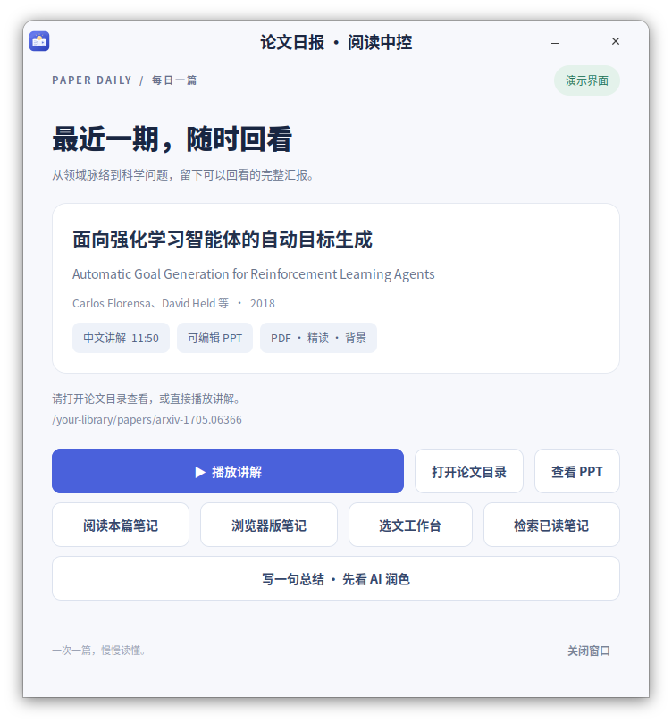

<div align="center">
  
  <h1>Paper Daily · 论文日报</h1>
  <p>每天一篇，读懂再积累。</p>
  <p>A local-first workflow for daily paper deep dives, narrated reports, and connected reading notes.</p>
</div>

[](https://github.com/tacmon/paper-daily/actions/workflows/tests.yml)
[](LICENSE)

让AI像研究生向导师汇报一样准备论文：从领域脉络和科学问题出发，讲清建模、方法、理论、实验与局限，留下PPT、中文讲解视频、PDF和可追溯的笔记。读完后，把自己的理解积累成每天一句。

**这是“AI精读工作流＋本地辅助软件”，目前是早期版本。** 阅读、调研和PPT创作由你配置的AI助手完成；仓库提供选文工作台、归档与校验、语义检索、视频合成辅助、笔记入口和桌面中控。克隆仓库不会自行创建定时任务或调用大模型。

## 操作演示

**2 分 23 秒，看看实际怎么用。** 这段无声桌面录屏展示了阅读中控、Obsidian／浏览器笔记、选文工作台检索和“每日一句”入口。

https://github.com/user-attachments/assets/da901b0e-477e-4724-ab40-d09a22e4b605

录制于 2026-11-18，界面与候选数据为当时版本。建议全屏观看；这是软件操作演示，论文的中文配音汇报需由你的 AI 工作流另行生成。

<details>
<summary>查看阅读中控静态示例</summary>



*这张静态截图使用公开论文题目构造示例，不附带图中PPT或论文讲解视频。*

</details>

## 能做什么

- **每天一篇完整精读**：工作流模板涵盖公开全文、引用、背景调研、PPT、中文讲稿/视频、字幕与笔记，强调科学问题和证据。
- **选文工作台**：从arXiv、公开会议目录、期刊和会议公布名单中有预算地采集；缓存、分页续接、去重与失败退避。默认主题偏强化学习和课程学习。
- **本地语义检索**：可选E5嵌入与SQLite索引，查候选摘要和已有笔记；模型不可用时退回关键词。排名只是选文线索。
- **桌面阅读中控**：Linux应用列表打开最近一期；完成后自动提醒。视频、PPT、Obsidian笔记、浏览器笔记与工作台一处直达。
- **Obsidian / Zotero**：复用原始Markdown；可将公开全文与引用导入本机Zotero。二者都需另行安装和配置。
- **每日一句**：直接保存自己的原话，或选择AI润色后再确认；不会悄悄代写最终判断。

## 快速开始

Python 3.10+。归档和关键词检索主要使用标准库；桌面窗口目前面向Linux GTK 3，本机验证过GNOME/X11。macOS/Windows桌面提醒尚未适配。

```bash
git clone https://github.com/tacmon/paper-daily.git
cd paper-daily
python3 scripts/init_library.py
python3 paper_library.py validate
```

这会生成被Git忽略的个人配置、空阅读记录和可打开的工作台。填写`reading_profile.md`，然后在有文件和浏览能力的AI助手中打开本项目，发送：

> 请先读 WORKFLOW.md 和我的 reading_profile.md，按照 pipeline_prompt.md 完成第一篇论文精读。

需要自行准备助手的工具和模型权限，以及PPT、音频等制作能力。先跑通一篇，再设置每天06:00的宿主定时任务；[设置指南](docs/setup.md)说明哪些步骤需要单独配置。

### 安装桌面中控（Ubuntu / Debian）

```bash
sudo apt install python3-gi gir1.2-gtk-3.0 librsvg2-common desktop-file-utils
/usr/bin/python3 scripts/install_desktop_app.py
/usr/bin/python3 scripts/paper_notify.py --open
```

系统应用列表搜索 **论文日报**。空库会显示提示；只有产物与验收完整的论文才显示完整卡片。安装器不会替你创建AI定时任务。

如需登录桌面后自动观察已完成报告：

```bash
/usr/bin/python3 scripts/install_desktop_app.py --autostart
/usr/bin/python3 scripts/paper_notify.py
```

手动窗口与自动提醒独立，关闭手动窗口不修改提醒记录。安装器不会覆盖另一目录已有的Paper Daily安装。

### 打开工作台

```bash
python3 prototype_v2/open_workbench.py --ensure
# 在浏览器访问 http://127.0.0.1:8766/
```

按钮默认寻找Chrome/Chromium并使用独立浏览器配置；可通过`PAPER_DAILY_BROWSER`指定可执行文件。不会复制个人浏览器Cookie或启用账号同步。

### 可选：本地向量检索

```bash
python3 -m venv .runtime/semantic-venv
.runtime/semantic-venv/bin/pip install -r prototype_v2/requirements-semantic.txt
.runtime/semantic-venv/bin/python prototype_v2/setup_model.py
timeout 300 .runtime/semantic-venv/bin/python prototype_v2/prepare.py
```

这会下载模型并访问公开论文来源，耗时、来源覆盖与网络有关。代理在本地`prototype_v2/sources.json`中配置；默认没有作者的代理地址。模型下载代理参数见`setup_model.py --help`。

## 目录与文档

| 入口 | 用途 |
| --- | --- |
| [WORKFLOW.md](WORKFLOW.md) | AI如何完成一篇可核验的精读 |
| [安装与日常使用](docs/setup.md) | 定时任务、提醒、配置与备份 |
| [集成说明](docs/integrations.md) | Obsidian、Zotero、PPT与TTS |
| [归档格式](docs/archive.md) | metadata、ready状态、作者与引用链接 |
| `prototype_v2/` | 来源采集、工作台、语义检索 |
| `scripts/` | 中控、安装器、笔记与制作辅助 |

## 隐私与限制

数据默认留在本机：论文库、个人偏好、反馈、每日一句、浏览器配置和缓存均不进入Git。公开来源采集会发送检索词；可选Edge TTS会把讲稿发送到其语音服务；AI助手的数据处理取决于你选择的服务。本项目不保存LLM密钥、不后台调用LLM，也不保证论文覆盖完整或报告事实自动正确。请保留原文定位并审阅关键结论。

模型、第三方服务与论文的许可不由本项目的MIT许可证替代；详见[第三方说明](THIRD_PARTY.md)。

## 开发与贡献

```bash
python3 -m unittest discover -p 'test_*.py'
python3 -m unittest discover -s prototype_v2 -p 'test_*.py'
```

测试使用临时合成数据，不依赖维护者的个人论文库或联网下载。欢迎Fork、Issue和PR；见[贡献说明](CONTRIBUTING.md)。

本项目从个人每日阅读实践中演进而来，使用AI协助开发。代码和图标采用[MIT许可证](LICENSE)。
